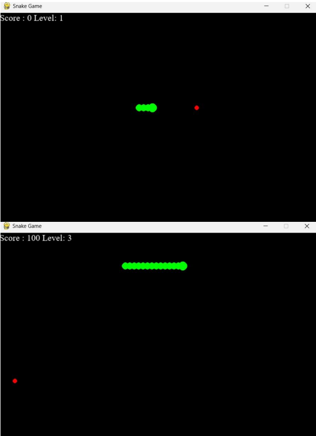

# Snake Game

A classic Snake game built with **Python and Pygame**, featuring screen wraparound, food collection, score tracking, and a persistent SQLite leaderboard.

Control the snake, collect food, increase your score, and try to beat your personal best!

## Preview

## Features

- **Classic Snake Gameplay** — Control the snake and collect food to increase your score.
- **Wall Wraparound** — Pass through any screen boundary and reappear on the opposite side.
- **Self-Collision Detection** — The game ends when the snake runs into its own body.
- **Dynamic Difficulty** — The snake's speed increases as your score grows.
- **Persistent Leaderboard** — Scores are stored in an SQLite database and remain available between sessions.
- **Restart Support** — Start a new game without restarting the application.

##  Built With

| Technology | Purpose |
|---|---|
| Python | Core game logic |
| Pygame | Game window, graphics, keyboard input, and game loop |
| SQLite | Persistent score storage |

## Requirements

- Python 3
- Pygame

SQLite is included with Python through the `sqlite3` module, so no separate database installation is required.

## Controls

| Key | Action |
|---|---|
| `↑` | Move up |
| `↓` | Move down |
| `←` | Move left |
| `→` | Move right |
| `R` | Restart after game over |
| `L` | View the leaderboard |
| `Q` | Quit from the game-over or leaderboard screen |

## How to Play

1. Control the snake using the arrow keys.
2. Eat the red food to earn **10 points**.
3. Each time you collect food, the snake grows.
4. Te snake moves faster as your score increases.
5. Avoid running into your own body.
6. Use the screen boundaries to wrap around to the opposite side.
7. Try to achieve the highest score possible!

## Leaderboard

The game uses SQLite to save player scores locally.

- Database file: `snake_game.db`
- Table: `scores`
- Stored information: player name and score
- Leaderboard: Displays the top five scores in descending order

The database is automatically created when the game starts. You do not need to configure it manually.

**Built with Python and Pygame.**
